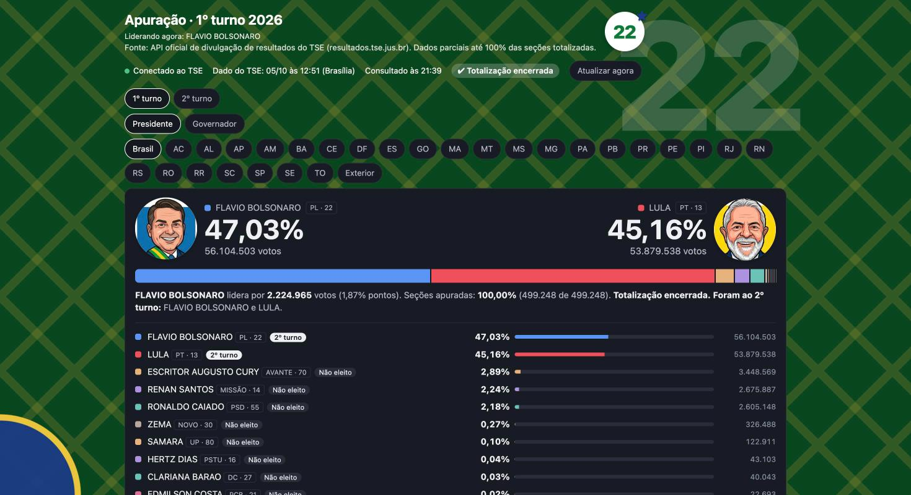
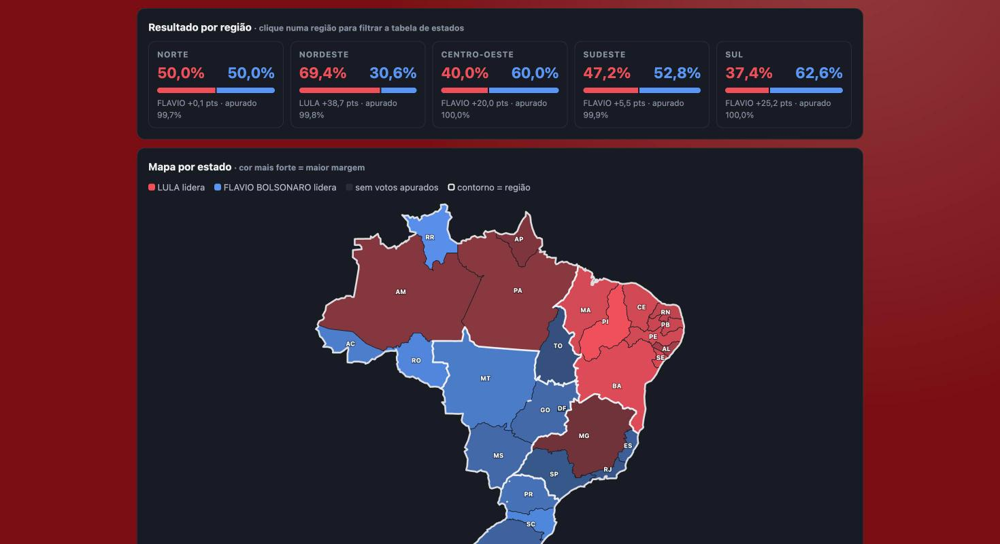
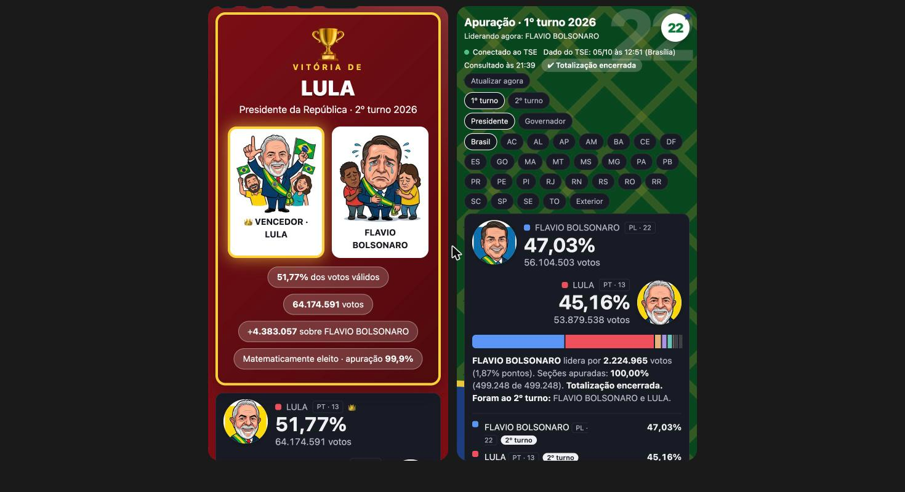

# Apuração ao vivo · Eleições 2026

Dashboard interativo que acompanhou, em tempo real, a apuração do **1º e do 2º turno das eleições 2026**, lendo diretamente a **API oficial de divulgação de resultados do TSE**. Feito do zero, em um único arquivo, sem framework e sem build.

**Acesse:** https://piaulucas.github.io/dashboard-eleicao-2026/


> Projeto independente, sem vínculo com o TSE nem com qualquer campanha. Apenas o TSE divulga o resultado oficial. As caricaturas foram geradas com IA. O visual partidário (vermelho do 13, verde e amarelo do 22) é um exercício de design de interface.

## O que ele faz

**1º e 2º turno.** Uma chave no topo alterna entre os dois turnos, cada um com **Presidente** e **Governador**.

- **Placar ao vivo** com percentual, votos e atualização automática a cada 60 s. No 1º turno, mostra o **ranking de todos os candidatos**, com a situação de cada um (eleito, vai ao 2º turno, não eleito).

  

- **Matematicamente eleito.** O resultado é declarado assim que se torna irreversível, sem esperar os 100%: a vantagem do líder é maior que todos os eleitores das seções ainda não totalizadas (2º turno) ou o líder garante mais da metade dos votos válidos possíveis (1º turno). Na Presidência: tela cheia com confete. Nos governos: aviso discreto no topo, mesmo com outra aba aberta, agrupado quando há vários eleitos.
- **Quadro do campeão**, com vencedor e derrotado:

  

- **Resultado por região** (Norte, Nordeste, Centro-Oeste, Sudeste e Sul) e **mapa do Brasil** colorido pelo partido de quem lidera cada estado (PT vermelho, PL azul), com contorno das regiões. Clicar numa região filtra a tabela de estados.

  

- **Tabela por estado** agrupada por região, ordenável, com subtotal por região.
- **Gráfico de evolução** do percentual, com um ponto por atualização.
- **Interface que muda conforme quem lidera**: fundo, marca d'água (13, 22 ou o número do partido), cores e caricaturas (quem lidera sorri, quem perde chora).
- **Responsivo**, com modo claro e escuro automáticos.

  

## Como os dados chegam

Sem back-end: o navegador consulta a API do TSE diretamente (ela libera CORS). O cache da API é de ~50 s, por isso o intervalo de 60 s.

```
https://resultados.tse.jus.br/oficial/ele2026/<eleição>/dados/<uf>/<uf>-c<cargo>-e<eleição>-u.json
```

| Turno | Presidente | Governador |
|---|---|---|
| 1º | eleição `6257` (cargo 1) | eleição `6259` (cargo 3), 27 estados |
| 2º | eleição `6258` (cargo 1) | eleição `6260` (cargo 3), AC, AM, DF, ES, RN e TO |

A lista de eleições está em `/oficial/comum/config/ele-c.json`. O mapa usa a malha de estados e de regiões da API do IBGE.

## Decisões técnicas e desafios

- **API não documentada.** Descobri o formato lendo o JavaScript do site oficial e validei os números contra o próprio site do TSE e o Google.
- **Dados defasados.** O TSE chegou a ficar mais de 1 hora sem publicar durante o 2º turno, e os arquivos por estado são publicados em momentos diferentes do total nacional. O dashboard mostra a hora de geração do dado (horário de Brasília) e avisa quando está defasado, em vez de fingir que está "ao vivo". Resultados já encerrados mostram "Totalização encerrada".
- **Declarar o eleito antes do TSE.** Nos dados reais, o TSE só marcava "Eleito" no fim, mesmo com 98% a 99% apurado. A regra do "matematicamente eleito" considera o pior cenário (todos os eleitores restantes votando no adversário), portanto não é projeção estatística: não erra, só pode demorar um pouco mais que uma projeção. Ela não considera anulação de seções nem recontagem.
- **Mapa sem biblioteca.** A malha do IBGE é projetada e desenhada em SVG puro, com cache local.
- **Cores por partido** definidas por variáveis CSS, com variantes para o modo escuro. Quando dois candidatos da mesma disputa têm cores parecidas, quem não é PT nem PL passa para a cor secundária do partido ou para uma cor livre.
- **Sem adivinhar gênero.** O arquivo do TSE não traz esse dado. Os candidatos a governador do 2º turno ganharam bonecos masculino e feminino a partir dos nomes registrados; os demais aparecem com um círculo com as iniciais.
- **Cada turno é uma chave de estado** (`pres`, `gov`, `pres1`, `gov1`), o que permitiu reaproveitar toda a interface para disputas com 2 ou com dezenas de candidatos.

## Tecnologias

HTML, CSS e JavaScript puros · SVG · API de resultados do TSE · API de malhas do IBGE · GitHub Pages.

## Como rodar

É um único `index.html`:

```sh
python3 -m http.server 8765
# abra http://localhost:8765
```

Parâmetros de teste na URL:

| Parâmetro | Efeito |
|---|---|
| `?t=1` | abre direto no 1º turno |
| `?demo=fim` | simula 100% apurado (tela de vitória) |
| `?demo=eleito` | simula governadores declarados eleitos (aviso no topo) |

## Estrutura

```
index.html        aplicação inteira (HTML, CSS e JS)
img/              caricaturas (recortes) de Lula e Flávio Bolsonaro
docs/             prints usados neste README
LICENSE           MIT
CONTRIBUTING.md   como contribuir
```

## Licença

O **código** está sob a [Licença MIT](LICENSE): você pode usar, copiar, modificar e distribuir, mantendo o aviso de copyright.

A licença **não cobre** o que não é código do projeto:
- As caricaturas em `img/` e os prints em `docs/` foram geradas com IA e retratam pessoas reais; não são licenciadas sob a MIT e não devem ser reutilizadas sem avaliar os termos da ferramenta que as gerou.
- Os dados exibidos pertencem às suas fontes oficiais: resultados do [TSE](https://resultados.tse.jus.br) e malha territorial do [IBGE](https://servicodados.ibge.gov.br).

## Contribuindo

Sugestões e correções são bem-vindas por *issue* ou *pull request*. Veja o [guia de contribuição](CONTRIBUTING.md) e o [código de conduta](CODE_OF_CONDUCT.md).

## Autoria

Projeto de autoria de **Lucas Piau**.
