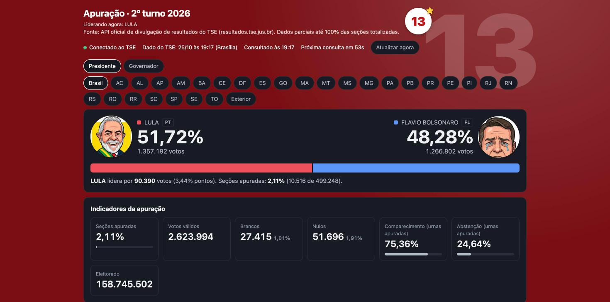
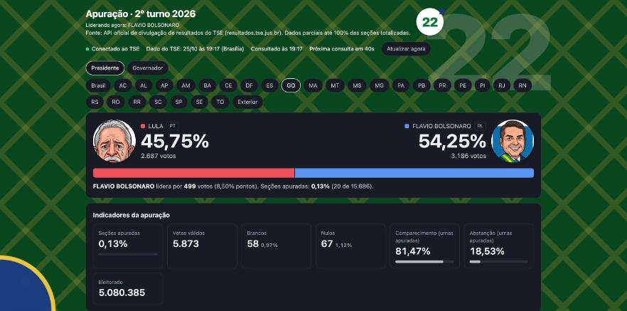
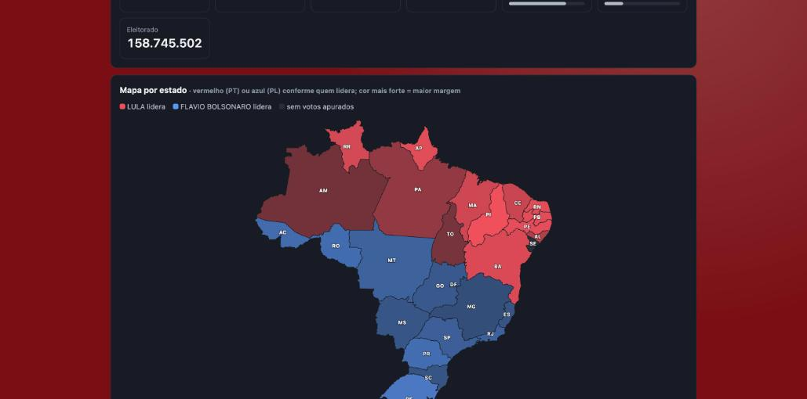
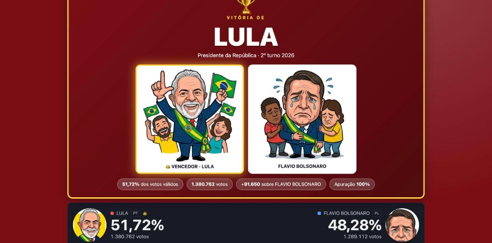
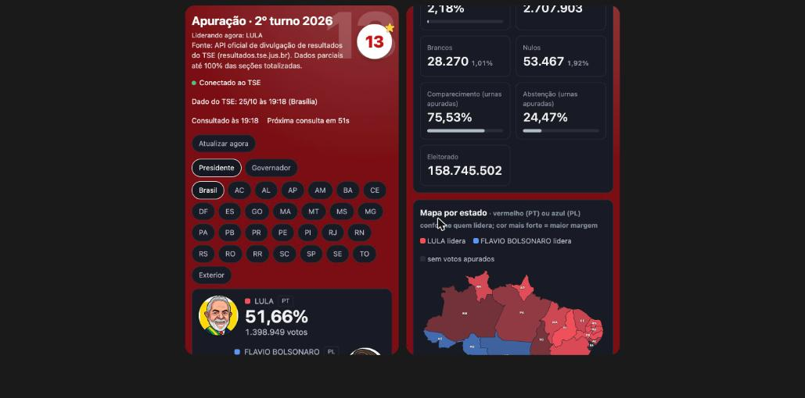

# Apuração ao vivo · 2º turno 2026

Dashboard interativo que acompanha a apuração das eleições em tempo real, lendo diretamente a **API oficial de divulgação de resultados do TSE**. Feito do zero, em um único arquivo, sem framework e sem build.

**Ao vivo:** https://piaulucas.github.io/dashboard-eleicao-2026/



> Projeto independente, sem vínculo com o TSE nem com qualquer campanha. Apenas o TSE divulga o resultado oficial. As caricaturas foram geradas com IA. O visual partidário (vermelho do 13, verde e amarelo do 22) é um exercício de design de interface.

## O que ele faz

- **Placar em tempo real** para Presidente (Brasil, 27 UFs e exterior) e Governador (estados com 2º turno), com atualização automática a cada 60 s.
- **Interface que muda conforme quem lidera**: fundo, marca d'água (13 ou 22), cores e caricaturas trocam sozinhos. Quem lidera aparece sorrindo com a faixa; quem está atrás, chorando.

  

- **Mapa do Brasil por estado**, colorido pelo partido de quem lidera (PT vermelho, PL azul), com intensidade proporcional à margem, tooltip e clique para detalhar.

  

- **Tabela por estado** ordenável, **gráfico de evolução** do percentual e indicadores (válidos, brancos, nulos, comparecimento, abstenção).
- **Quadro de campeão** acionado pela marcação oficial do TSE (candidato com status "Eleito", que pode vir antes dos 100% apurados) ou, na falta dela, com **100% das seções totalizadas**. Na Presidência: tela cheia com confete e um card com vencedor e derrotado. Nos governos: um aviso discreto no topo ("Governadora eleita · DF"), mesmo com outra aba aberta, e o card no estado. O dashboard **não faz projeção própria**; só reflete o que o TSE declara.

  

  *Print gerado no modo de demonstração (`?demo=fim`), que simula 100% apurado. Não é um resultado real.*

- **Responsivo**, com modo claro e escuro automáticos.

  

## Decisões técnicas e desafios

- **Descoberta da API.** O TSE não documenta os endpoints do 2º turno de 2026. Descobri o formato (`/oficial/ele2026/<eleição>/dados/<uf>/<uf>-c<cargo>-e<eleição>-u.json`) lendo o JavaScript do site oficial, e validei os números contra o próprio site e o Google.
- **Sem back-end.** A API do TSE libera CORS, então o navegador consulta direto. O cache da API é de cerca de 50 s, por isso o intervalo de 60 s.
- **Dados defasados e inconsistentes.** O TSE chegou a ficar mais de 1 h sem publicar (votação prorrogada), e os arquivos por estado são publicados em momentos diferentes do total nacional. O dashboard mostra a hora de geração do dado (horário de Brasília) e um aviso de defasagem, em vez de fingir que está "ao vivo".
- **Regra do campeão.** O vencedor é quem o TSE marca como eleito (campo `e = s` / status "Eleito" nos dados) ou, na falta disso, quando `seções totalizadas ≥ total de seções`, sem arredondar o percentual. Nada de projeção própria: numa eleição, anunciar errado é pior que anunciar um pouco depois.
- **Mapa sem biblioteca.** A malha de estados vem da API do IBGE e é projetada e desenhada em SVG puro no próprio código, com cache local.
- **Cores por partido** definidas por variáveis CSS, com variantes para o modo escuro.

## Tecnologias

HTML, CSS e JavaScript puros · SVG · API de resultados do TSE · API de malhas do IBGE · GitHub Pages.

## Como rodar

É um único `index.html`:

```sh
python3 -m http.server 8765
# abra http://localhost:8765
```

`?demo=fim` simula 100% apurado (tela de vitória) e `?demo=eleito` simula governadores declarados eleitos (aviso no topo).

## Licença

O **código** está sob a [Licença MIT](LICENSE): você pode usar, copiar, modificar e distribuir, mantendo o aviso de copyright.

A licença **não cobre** o que não é código do projeto:
- As caricaturas em `img/` e os prints em `docs/` foram geradas com IA e retratam pessoas reais; não são licenciadas sob a MIT e não devem ser reutilizadas sem avaliar os termos da ferramenta que as gerou.
- Os dados exibidos pertencem às suas fontes oficiais: resultados do [TSE](https://resultados.tse.jus.br) e malha territorial do [IBGE](https://servicodados.ibge.gov.br).

## Contribuindo

Sugestões e correções são bem-vindas por *issue* ou *pull request*. Veja o [guia de contribuição](CONTRIBUTING.md) e o [código de conduta](CODE_OF_CONDUCT.md).

## Autoria

Projeto de autoria de **Lucas Piau**.
